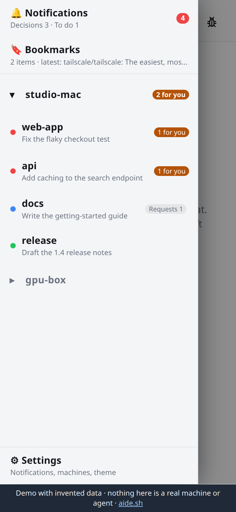
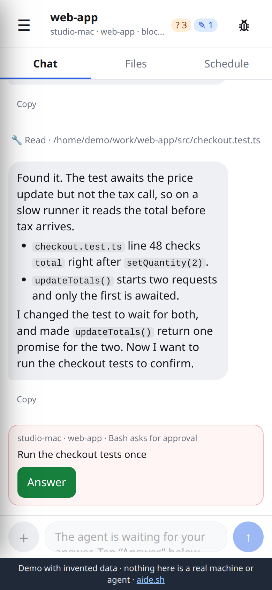
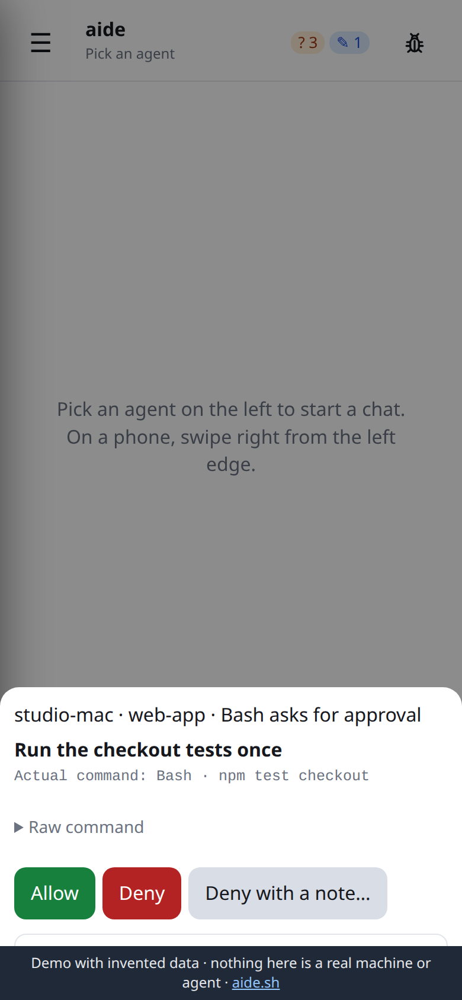
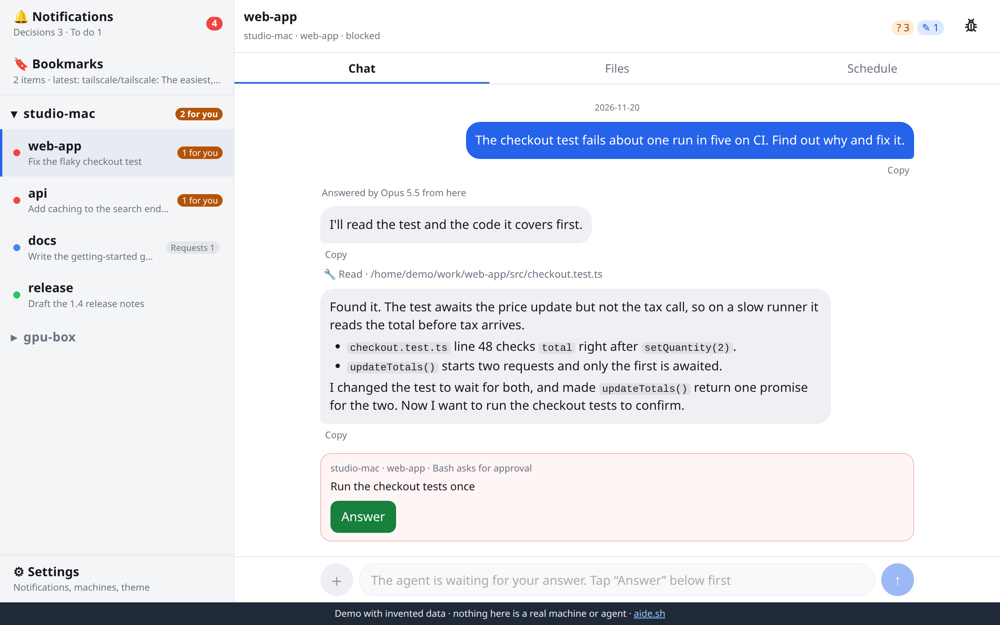
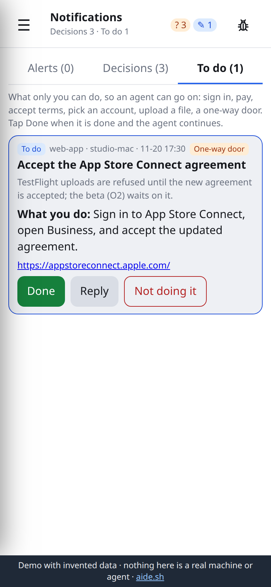
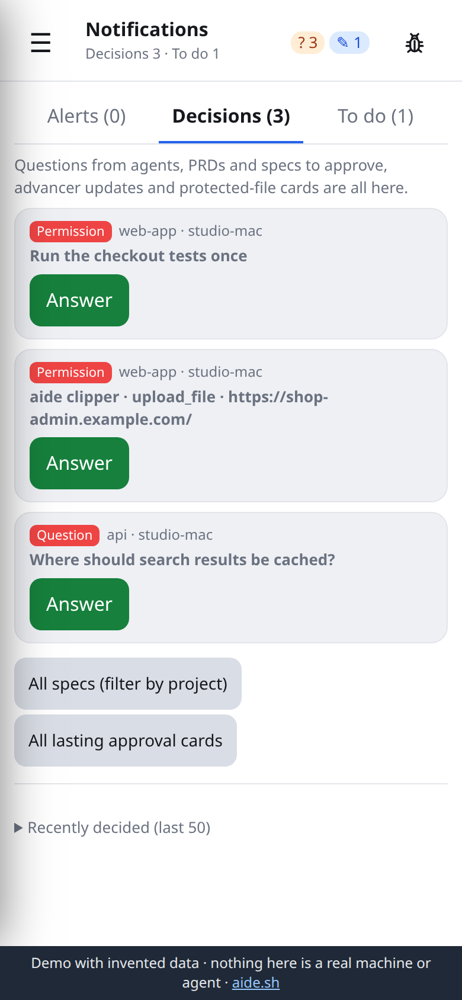
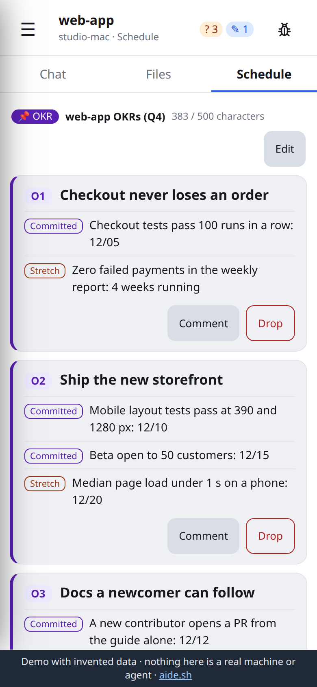
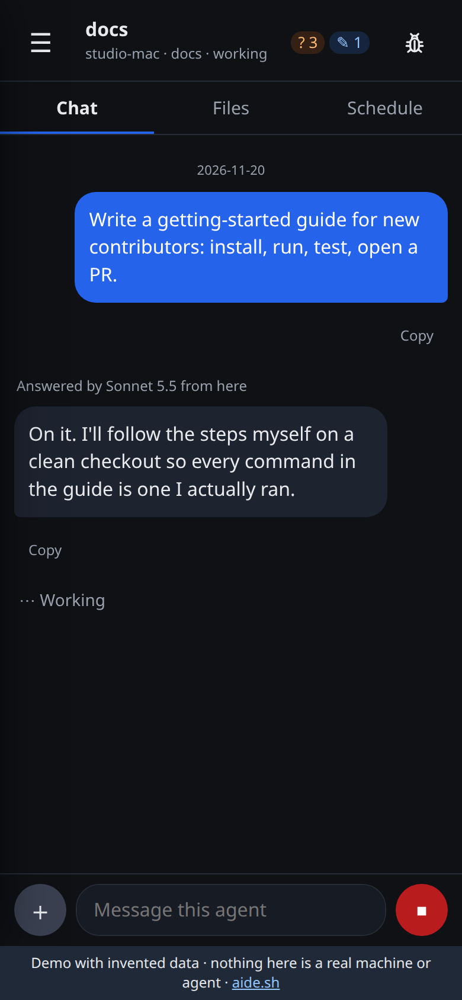
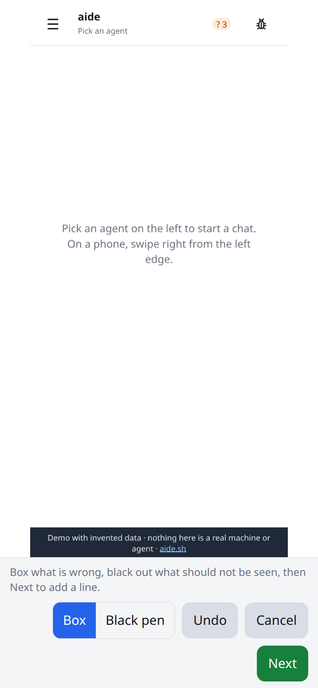
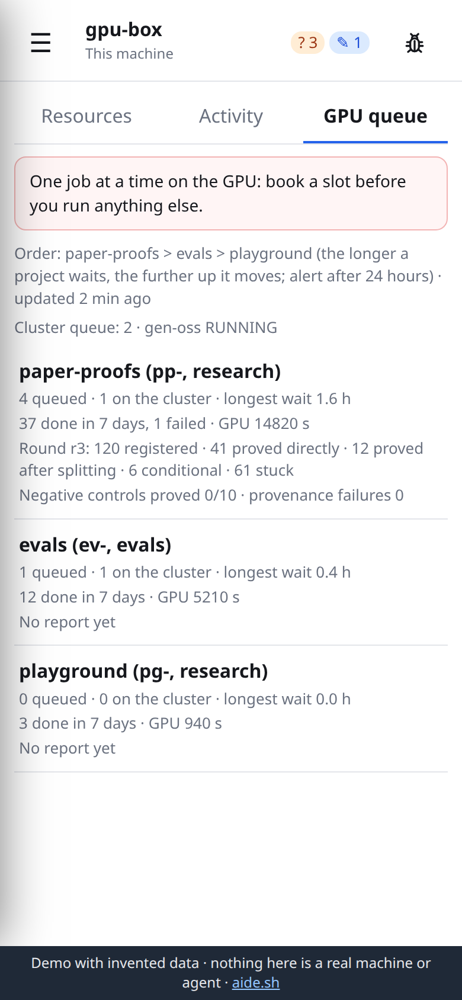

# aide RWD portal

The web page of the aide portal, on its own: one phone-first page to watch and talk to coding agents on
several machines. You can read the agents' chats, answer their permission prompts and questions, and see
what is waiting for you. This repo has the page, the API it talks to, and screenshots, so that you or an
agent can build the same page on another backend.

Everything here runs on invented data. No machine, agent or person in it is real.

| Phone: agents | Phone: chat | Phone: a prompt to answer | Desktop |
|---|---|---|---|
|  |  |  |  |

| Notifications: to do | Decisions | OKR, one card per objective | Dark |
|---|---|---|---|
|  |  |  |  |

| Screenshot a bug | GPU queue |
|---|---|
|  |  |

## Look at it

```sh
python3 -m http.server 8000
# open http://localhost:8000/ — on a phone, or a narrow window
```

Links that open one view directly: `#agent=web-app`, `#agent=web-app&tab=jobs`, `#card=1`,
`#view=confirm&tab=alerts|pending|asks|history`, `#machine=gpu-box&tab=gpu`, `#host=studio-mac&side=1`, `#shot=1`.

## What is in the repo

| File | What it is |
|---|---|
| `index.html` | The real page: CSS, markup and script in one file. Comments are removed, everything else is as it ships. |
| `API.md` | Every route the server answers, the query keys and body keys, and example answers. |
| `screenshots/` | Phone (390×844) and desktop (1280×800) views, at 2×. |
| `vendor/html2canvas.js` | html2canvas 1.4.1 (MIT, its licence header kept), loaded only by the screenshot button. |
| `vendor/pdf.min.mjs`, `vendor/pdf.worker.min.mjs` | pdf.js 4.10.38, legacy build (Apache-2.0), loaded only when a PDF is opened. |
| `THIRD_PARTY_NOTICES.md` | The licences of the two libraries above. |

`index.html` starts with one extra script: a fake `fetch` that answers `/api/*` from a recording and turns
every action into a no-op. Delete that first `<script>` and the page talks to a real server at the same origin.
The bar at the bottom ("Demo with invented data") is also added for the demo.

## Building the same page somewhere else

1. Serve `index.html` without the first script.
2. Answer the routes in `API.md`. Agents and chat use `GET /api/agents`, `GET /api/agents/messages` and
   `POST /api/agents/send`; the other routes feed the other views. The demo answers `[]` or `{}` for every
   route it has no recording for, and the page still works.
3. Auth: pairing (`POST /pair` with a one-time token) sets an HttpOnly cookie, and the page sends it with every request
   (`credentials: 'include'`). Every write also carries the header `x-aide-approve: 1`. A 401 shows the pairing screen.

The layout in short:

- **Below 820 px** the agent list is a drawer from the left edge (swipe right, or ☰). **Above 820 px** it is a
  fixed column. Below 480 px every button and field is at least 44 px tall, so it is easy to tap.
- **One column of content**: header (agent, machine, state, "N waiting"), tabs (Chat, Files, Schedule), the
  chat log, and the message box at the bottom. Hold the send button for quick replies.
- **Prompts to answer** show as red cards in the chat; "Answer" opens a panel with one big button per choice.
- **Notifications** (🔔 in the side list, the pills in the header) hold three kinds of stuck: **Alerts** (a
  machine unreachable, a quota at its line, a disk or memory nearly full, OOM kills), **Decisions** (an agent's
  question or a document to approve) and **To do** (what only the user can do, filed by an agent).
- **Screenshot a bug**: the header button draws the page with html2canvas, lets you box what is wrong with rounded
  rectangles, and sends it as a bug report.
- **Light and dark** follow the system; Settings → Theme switches them. Colours are CSS variables at the top: five
  status tones (danger, warning, info, accent, success), each with a tinted `-bg`, a `-fg` and a `-solid`,
  defined for both themes. Badges are tinted; only buttons that act are filled.
- **Two languages**: Chinese and English. `tr()` looks up English text in the `EN` table; Settings switches the
  language.

## Where it comes from

The page is part of `aide approve serve` in the aide repository (not public yet). This copy is made from the demo recording:
`demo/record.sh` records the page against invented data, `node demo/build.mjs --readable` writes
`index.html`, and `node demo/contract.mjs` writes `API.md`. Both refuse to write anything that looks like a
real machine, path or person.

## License

Apache-2.0. See `LICENSE`. The files under `vendor/` keep their own licences (`THIRD_PARTY_NOTICES.md`).

## Status

This is the first public cut (2026-11-23). The page is what the author runs every day; the server it talks to
is not public yet, so the page here runs on recorded, invented data. Issues and questions are welcome; expect
the API in `API.md` to change before the server is released.

## Kept in sync

This copy follows the aide portal: each portal release is recorded again and this repo is regenerated
(`index.html`, `API.md`, `screenshots/`), so it never lags the running portal by more than one release.
`SOURCE` names the commit of the portal it was made from.
